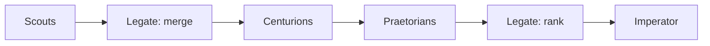

# cause-n-effect

Finds investment leads early: spending signals (capex, debt raises, orders, stake building, insider buying) that the market hasn't priced in yet.

## Architecture
Python scripts do the deterministic work: fetching, parsing, storing and diffing. Agents only handle judgment, which keeps token spend low. The sweep from scouts to the weekly shortlist is designed in [docs/pipeline-architecture.md](docs/pipeline-architecture.md).

**Scouts to Centurions.** Scouts surface leads from each dataset, and the merge to prioritise pairs a buyer's capex lead with a different company's orders_backlog lead only when a filing links them (the buyer names the supplier, the supplier names the customer or contract, or another official-source link, recorded on `legate_merges`; a bare sector match is not enough), with same-company supportive merges still allowed under that evidence rule. Each Centurion gets a lead-matched rules file for that single lead and autonomously grades it, then writes one thesis with potential ROI, risks, timeframe, and stated assumptions ([Centurions/README.md](Centurions/README.md)).

**Praetorians.** Praetorians only critique, attacking the stated assumptions, weak sources, and conclusions with counter-evidence ([Praetorians/README.md](Praetorians/README.md)). They state no assumptions of their own.

**Legate.** The Legate ranks the critiqued findings: fewest surviving issues, highest ROI, and shortest timeframe first, then by remaining risk count and size, lower return, or longer time. The ranked list goes to the Imperator, who decides.

**After the decision.** Each lead is tracked as acted on, not acted on, or pending. Acted-on leads are monitored against their thesis using live brokerage portfolio data (position and profit and loss), and those outcomes feed back.

## Data
- SQLite history DB: time-stamped figures with source links and a verified flag, diffed run to run.
- How to open a read-only snapshot is in [docs/database-access.md](docs/database-access.md).
- Official sources only: SEC EDGAR, ASX announcements, company releases. Blogs and media are banned. Prices come from quote data.
- Access: free SEC API throttled to 0.15s per request with an email User-Agent, ASX website feed with 2s gaps and health checks. All requests go through `shared/nethttp.py`.

## Scouts
1. **Capex**: big spenders' capex, traced to tier-2 and tier-3 suppliers.
2. **Debt raises**: loans, facilities and bonds, run through a two-stage use-of-proceeds filter with threshold analytics.
3. **orders_backlog**: customer-reported backlog plus supplier order announcements.
4. **Accumulation**: 13D/13G filings and ASX substantial holder notices.
5. **Insider buying**: Form 4s and ASX 3Ys, with CEO buys and cluster buying flagged.

## Roles
- **Scouts** find leads.
- **Centurions** research one lead. Spin-up is in [Centurions/README.md](Centurions/README.md).
- **Praetorians** critique that output. The job is in [Praetorians/README.md](Praetorians/README.md).
- **Legate** is the AI Portfolio Manager. It prioritises a cross-company capex-to-backlog merge when a filing links the two leads, still merges other supportive leads on the same evidence, then ranks what survives critique.
- **Imperator** is the human who decides and places trades himself.

## Legate

The Legate is the Portfolio Manager and the last stage before the Imperator. After the Praetorians have critiqued the research, the Legate ranks it.

Rank 1 is the strongest: the fewest Praetorian issues still standing, the highest ROI, and the shortest timeframe. Rank 2, rank 3, rank 4, and the rest step down as more risks remain, as those risks get larger, as the ROI gets lower, or as the timeframe gets longer.

The ranked list goes to the Imperator. He makes the final decision and places the trades himself.

## After the decision

The Imperator tells the Legate which ranked findings he will act on, or that he will act on none.

Acting on a lead means he has taken a position in his brokerage account at Interactive Brokers. The Legate reads that portfolio and does not place orders.

The system then does two things.

1. **Track status** on `leads` for every ranked finding. Pending stays `presented` until he answers. Acted on becomes `acted`, and stays `position` while the holding is open. Not acted on, including when he passes on all of them, becomes `rejected`. A later lead about an open holding sets `parent_position_id` to that `acted` or `position` row. When the holding is no longer open, status moves to `closed`.
2. **Monitor** each acted-on lead against the Centurion's thesis, predicted ROI, stated risks, and timeframe. The comparison uses live portfolio data from that brokerage account: actual position performance and profit and loss. Those results are written back to the lead's `outcome`. That record is what a later rubric version is tuned from.

## Status
Structure and tests only, no live runs yet. A weekly Saturday report is planned.
