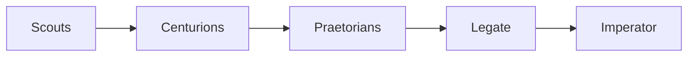

# cause-n-effect

Finds investment leads early: spending signals (capex, debt raises, orders, stake building, insider buying) that the market hasn't priced in yet.

## Architecture
A Portfolio Manager agent (the Legate) orchestrates the scouts. Python scripts do the deterministic work: fetching, parsing, storing and diffing. Agents only handle judgment, which keeps token spend low.

## Data
- SQLite history DB: time-stamped figures with source links and a verified flag, diffed run to run.
- Official sources only: SEC EDGAR, ASX announcements, company releases. Blogs and media are banned. Prices come from quote data.
- Access: free SEC API throttled to 0.15s per request with an email User-Agent, ASX website feed with 2s gaps and health checks. All requests go through `shared/nethttp.py`.

## Scouts
1. **Capex**: big spenders' capex, traced to tier-2 and tier-3 suppliers.
2. **Debt raises**: loans, facilities and bonds, run through a two-stage use-of-proceeds filter with threshold analytics.
3. **Orders-backlog**: customer-reported backlog plus supplier order announcements.
4. **Accumulation**: 13D/13G filings and ASX substantial holder notices.
5. **Insider buying**: Form 4s and ASX 3Ys, with CEO buys and cluster buying flagged.

## Roles

- **Scouts** find leads.
- **Centurions** research leads past the threshold into theses.
- **Praetorians** attack each thesis.
- **Legate** is the AI Portfolio Manager running the field.
- **Imperator** is the human who decides.

## Status
Structure and tests only, no live runs yet. A weekly Saturday report is planned.
