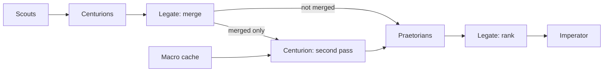

# cause-n-effect

Finds investment leads early: spending signals (capex, debt raises, orders, stake building, insider buying) that the market hasn't priced in yet.

## Architecture
Python scripts do the deterministic work: fetching, parsing, storing and diffing. Agents only handle judgment, which keeps token spend low. The path from a scout finding to the weekly shortlist is designed in [docs/pipeline-architecture.md](docs/pipeline-architecture.md).

**Scouts.** Scouts are the cheap filter: thresholds and dedupe run first, then an external agent judges magnitude, novelty, attention, and timing from a task file, and only a surviving lead is stored. Data-collection modules stay separate. The sweep then combines a capex chain and a smart-money lead where the filings link, and each of those findings is one Centurion task. The sweep does not call a model. The handoff is in [docs/agent-protocol.md](docs/agent-protocol.md).

**Centurions.** One Centurion takes one lead and the rules file for that lead's type, researches only that lead, and writes one thesis ([Centurions/README.md](Centurions/README.md)). A capex Centurion works out what the spending is on and which suppliers it reaches; an orders_backlog Centurion works out which customers the orders came from.

**Capex chain and smart money.** Before the Centurion, linkable capex, orders backlog, and debt raises become one lead (spender, suppliers with backlog, and the funding raise). Insider buying and accumulation on the same ticker, inside the window, become one smart-money lead. Macro stays a lead of its own, and its Centurion task includes related findings such as refiners and tankers on a Brent move. An unlinked figure stays a single lead. A leftover cross-group link can still be merged after the theses exist, and only that leftover goes back for a second pass.

**Macro.** The Macro scout caches official macro context and does not emit leads ([Scouts/macro/README.md](Scouts/macro/README.md)). Each series keeps a `fetched_at` time and a staleness threshold, and a series is fetched again only when that threshold has passed, so the second-pass Centurion reads the cache instead of pulling it again.

**Second pass.** That Centurion runs a fresh full pass on the merged lead alone: grade, thesis, potential ROI, risks, timeframe, stated assumptions, and the macro context from the Macro scout's cache. On any prior price run it classifies the run first as a new thesis, an acceleration of an existing thesis, or tail end / likely priced in, with reasoning and evidence, and notes that call as a concern where relevant.

**Praetorians.** Praetorians critique an unmerged thesis straight from the first pass, and a merged finding only after its second-pass thesis. They write every flaw as flaw, severity, and evidence ([Praetorians/README.md](Praetorians/README.md)). They do not reject, drop, or filter a lead.

**Legate rank.** The Legate ranks every critiqued thesis. The score is expected return, plus growth and magnitude, minus deterministic surviving issues. Praetorian flaws are shown and do not change the score or remove a lead. A merged thesis is one entry. Ranking writes every candidate. The Legate then selects at most five, and that selection is the final report. The Imperator decides.

**After the decision.** Each lead is tracked as acted on, not acted on, or pending. Acted-on leads are monitored against their thesis with live brokerage portfolio data (position and profit and loss), and those outcomes feed back.

## Data
- SQLite history DB: time-stamped figures with source links and a verified flag, diffed run to run.
- How to open a read-only snapshot is in [docs/database-access.md](docs/database-access.md).
- Figures come only from SEC EDGAR, ASX announcements, and company releases. Macro series come from official statistics agencies, central banks, and treasuries, including FRED, the BLS, the ABS, and the RBA. Media and aggregators may be checked only to judge whether a lead was already noticed. Prices come from quote data.
- Access: free SEC API throttled to 0.15s per request with an email User-Agent, ASX website feed with 2s gaps and health checks. All requests go through `shared/nethttp.py`.

## Scouts
Pulling a filing is not a lead: each survivor stores a short label and a one-line reason for magnitude, novelty, attention, and timing, and a reject is logged with those fields so it can be found later by ticker or by a named buyer, supplier, or customer. Media may be checked only to see whether anyone has already noticed the item; the figures stay on official sources.

A lead that is stored goes to one Centurion, which writes one individual thesis. After the Centurions write those theses, the Legate merges linked theses. Only a merged finding goes back to one Centurion for a second, fresh full thesis pass. A lead that is not merged gets no second pass and goes straight to the Praetorians for critique. A merged finding goes to the Praetorians after that second-pass thesis.

That second pass includes a priced-in check on any prior price run. The Centurion makes the call first, classifying the run as a new thesis, an acceleration of an existing thesis, or tail end / likely priced in, with its reasoning and evidence. It notes that call as a concern where relevant. There is no automatic rejection. The stock price and past performance come from quote data. The Praetorians then write every flaw in the thesis, including any objection to that classification, as flaw, severity, and evidence. The lead stays in ranking.

1. **Capex**: big spenders' capex, traced to tier-2 and tier-3 suppliers.
2. **Debt raises**: loans, facilities and bonds, run through a two-stage use-of-proceeds filter with threshold analytics.
3. **orders_backlog**: customer-reported backlog plus supplier order announcements.
4. **Accumulation**: 13D/13G filings and ASX substantial holder notices.
5. **Insider buying**: Form 4s and ASX 3Ys, with CEO buys and cluster buying flagged.
6. **Macro**: cached rates, inflation, central-bank balance sheets, credit spreads, the dollar, oil and gas, fiscal balances, and supply-chain pressure, plus a placeholder for geopolitics, election, and regulatory notes. It does not emit leads. The second-pass Centurion reads `macro_series` and `macro_observations`.

## Roles
- **Scouts** find leads. They do not merge them. The Macro scout caches context and does not emit leads.
- **Centurions** research one lead into one thesis. Spin-up is in [Centurions/README.md](Centurions/README.md). Only a merged finding comes back for a second, fresh full thesis pass.
- **Praetorians** critique theses only: an unmerged thesis straight from the first pass, and a merged finding after its second-pass thesis. They write every flaw, with severity and evidence, and the lead stays in ranking. The job is in [Praetorians/README.md](Praetorians/README.md).
- **Legate** is the AI Portfolio Manager. After the individual theses exist it merges linked ones, sends only each merge back for a second pass, and ranks after critique.
- **Imperator** is the human who decides and places trades himself.

## Praetorians

Praetorians receive theses for critique, and critique is their only job. A thesis the Legate does not merge gets no second pass and comes straight from the first Centurion thesis. A merged finding comes only after its second-pass thesis. They write every flaw they find as flaw, severity, and evidence. An objection to the Centurion's price-run classification is one of those flaws. They do not reject, drop, or filter a lead. They have no assumptions section.

They record an assumption that does not hold, a source other than an SEC filing, an ASX announcement, or a company release, and research that contradicts the Centurion. Each item is one flaw with the evidence for it.

## Legate

The Legate does not merge scout leads. Scouts and the first Centurion pass stay one lead to one Centurion.

After each of those Centurions has written an individual thesis, the Legate reads across the theses and merges any the research shows are linked. The merge to prioritise is cross-company capex-to-backlog: a capex thesis that shows what the buyer is spending, and with which supplier, paired with that supplier's orders_backlog thesis. Same-company merges of supportive theses are allowed. A merge rests on the Centurions' researched findings, not on the raw scout rows. The link has to be traceable official-source evidence: the buyer's filing names the supplier, the supplier's filing names the customer or contract, or another official-source link the research cites. A sector match is not enough. That evidence is stored in `legate_merges.rationale`.

Only a merged finding goes back to one Centurion as a single new lead. That Centurion runs a second, fresh full thesis pass and writes one new thesis: grade, potential ROI, risks, timeframe, and stated assumptions. A lead that is not merged gets no second pass and goes straight to the Praetorians for critique. A merged finding goes to the Praetorians after that second-pass thesis.

After that critique, the Legate ranks every thesis. The score is expected return, plus growth and magnitude, minus deterministic surviving issues. Praetorian flaws are shown and do not change the score or remove a lead. A merged thesis is one entry on the list. The Legate then selects at most five of those candidates. The Imperator reads that selection and places the trades himself.

## After the decision

The Imperator tells the Legate which ranked findings he will act on, or that he will act on none.

Acting on a lead means he has taken a position in his brokerage account at Interactive Brokers. The Legate reads that portfolio and does not place orders. No account identifiers are stored in this repo.

1. **Track status** on `leads` for every lead. Pending stays `presented` until he answers. Acted on becomes `acted`, and stays `position` while the holding is open. Not acted on, including when he passes on all of them, becomes `rejected`. A later lead about an open holding sets `parent_position_id` to that `acted` or `position` row. When the holding is no longer open, status moves to `closed`.
2. **Monitor** each acted-on lead against the Centurion's thesis, predicted ROI, stated risks, and timeframe. The comparison uses live portfolio data from that brokerage account: actual position and profit and loss. Those results are written back to the lead's `outcome`. That record is what a later rubric version is tuned from.

## Status
Scouts are fixture-tested. The sweep from figures to pending decisions runs with `python -m pipeline run`, then `python -m pipeline ingest` after an agent writes each stage's result files (see [docs/setup.md](docs/setup.md) and [docs/agent-protocol.md](docs/agent-protocol.md)). A weekly Saturday report is planned.
