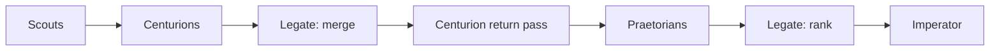

# cause-n-effect

Finds investment leads early: spending signals (capex, debt raises, orders, stake building, insider buying) that the market hasn't priced in yet.

## Architecture
Python scripts do the deterministic work: fetching, parsing, storing and diffing. Agents only handle judgment, which keeps token spend low. The path from a scout finding to the weekly shortlist is designed in [docs/pipeline-architecture.md](docs/pipeline-architecture.md).

**Scouts.** Scouts surface leads from each dataset. Each lead is one-to-one with a Centurion, and scouts do not merge leads.

**Centurions.** One Centurion takes one lead and the rules file for that lead's type, researches only that lead, and writes one thesis ([Centurions/README.md](Centurions/README.md)). A capex Centurion works out what the spending is on and which suppliers it reaches; an orders_backlog Centurion works out which customers the orders came from.

**Legate merge.** After those individual theses exist, the Legate merges any the research shows are linked, chiefly a buyer's capex thesis with a different company's orders_backlog thesis, and only when official-source evidence from that research is stored in `legate_merges.rationale` (a sector match is not enough); same-company supportive merges are allowed. Each merged finding goes back to one Centurion as a single new lead.

**Return pass.** That Centurion runs a fresh full pass on the new lead alone: grade, thesis, potential ROI, risks, timeframe, and stated assumptions. Leads the Legate does not merge keep the thesis from the first pass.

**Praetorians.** Praetorians only critique the final theses, both the unmerged individual theses and the new merged-lead theses, attacking stated assumptions, weak sources, and conclusions with counter-evidence ([Praetorians/README.md](Praetorians/README.md)). They state no assumptions of their own.

**Legate rank.** The Legate ranks those critiqued theses: fewest surviving issues, highest ROI, and shortest timeframe first, then by remaining risk count and size, and a merged thesis is one entry. The ranked list goes to the Imperator, who decides.

**After the decision.** Each lead is tracked as acted on, not acted on, or pending. Acted-on leads are monitored against their thesis with live brokerage portfolio data (position and profit and loss), and those outcomes feed back.

## Data
- SQLite history DB: time-stamped figures with source links and a verified flag, diffed run to run.
- How to open a read-only snapshot is in [docs/database-access.md](docs/database-access.md).
- Official sources only: SEC EDGAR, ASX announcements, company releases. Blogs and media are banned. Prices come from quote data.
- Access: free SEC API throttled to 0.15s per request with an email User-Agent, ASX website feed with 2s gaps and health checks. All requests go through `shared/nethttp.py`.

## Scouts
1. **Capex**: big spenders' capex, traced to tier-2 and tier-3 suppliers.
2. **Debt raises**: loans, facilities and bonds, run through a two-stage use-of-proceeds filter with threshold analytics.
3. **orders_backlog**: customer-reported backlog plus supplier order announcements.
4. **Accumulation**: 13D/13G filings and ASX substantial holder notices.
5. **Insider buying**: Form 4s and ASX 3Ys, with CEO buys and cluster buying flagged.

## Roles
- **Scouts** find leads. They do not merge them.
- **Centurions** research one lead into one thesis. Spin-up is in [Centurions/README.md](Centurions/README.md).
- **Praetorians** critique the final theses only. The job is in [Praetorians/README.md](Praetorians/README.md).
- **Legate** is the AI Portfolio Manager. After the individual theses exist it merges linked ones, sends each merge back as one lead, then ranks after critique.
- **Imperator** is the human who decides and places trades himself.

## Praetorians

Praetorians receive the final theses only: individual theses the Legate did not merge, and the new thesis written on the return pass for a merged lead. Critique is their only job. They have no assumptions section.

They challenge an assumption that does not make sense, and why; research taken from a bad source or from anything other than an SEC filing, an ASX announcement, or a company release; and further research that contradicts the Centurion. They argue the other side of every claim. Counter-evidence is aimed at the Centurion's stated assumptions, sources, and conclusions.

## Legate

The Legate does not merge scout leads. Scouts and the first Centurion pass stay one lead to one Centurion.

After each of those Centurions has written an individual thesis, the Legate reads across the theses and merges any the research shows are linked. The merge to prioritise is cross-company capex-to-backlog: a capex thesis that shows what the buyer is spending, and with which supplier, paired with that supplier's orders_backlog thesis. Same-company merges of supportive theses are allowed. A merge rests on the Centurions' researched findings, not on the raw scout rows. The link has to be traceable official-source evidence: the buyer's filing names the supplier, the supplier's filing names the customer or contract, or another official-source link the research cites. A sector match is not enough. That evidence is stored in `legate_merges.rationale`.

Each merged finding goes back to one Centurion as a single new lead. That Centurion runs a fresh full pass and writes one new thesis: grade, potential ROI, risks, timeframe, and stated assumptions. Praetorians then critique the final set.

After that critique, the Legate ranks. Rank 1 has the fewest surviving Praetorian issues, the highest ROI, and the shortest timeframe. Later ranks step down by how many risks remain and how large those risks are. A merged thesis is one entry on the list. The ranked list goes to the Imperator. He decides and places the trades himself.

## After the decision

The Imperator tells the Legate which ranked findings he will act on, or that he will act on none.

Acting on a lead means he has taken a position in his brokerage account at Interactive Brokers. The Legate reads that portfolio and does not place orders. No account identifiers are stored in this repo.

1. **Track status** on `leads` for every lead. Pending stays `presented` until he answers. Acted on becomes `acted`, and stays `position` while the holding is open. Not acted on, including when he passes on all of them, becomes `rejected`. A later lead about an open holding sets `parent_position_id` to that `acted` or `position` row. When the holding is no longer open, status moves to `closed`.
2. **Monitor** each acted-on lead against the Centurion's thesis, predicted ROI, stated risks, and timeframe. The comparison uses live portfolio data from that brokerage account: actual position and profit and loss. Those results are written back to the lead's `outcome`. That record is what a later rubric version is tuned from.

## Status
Structure and tests only, no live runs yet. A weekly Saturday report is planned.
