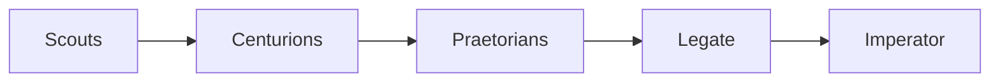

# cause-n-effect

Cause and effect investment agent orchestration.

## Architecture

Five roles. Scout software, in each folder under `scouts/`, does the deterministic work: fetching, parsing, storing, and diffing time-stamped figures in SQLite.

- **Imperator** — the human owner. Decides which theses to act on, and places the trades.
- **Legate** — the AI assistant, the Portfolio Manager. Runs the field for the Imperator: dispatches the other agents, applies thresholds, and brings ranked theses up.
- **Scouts** — the data-finding agents, formerly the exploratores. They are accumulation, orders-backlog, debt-raise, insider-buying, and capex.
- **Centurions** — researchers. They take scout findings that score past a threshold and develop them into theses.
- **Praetorians** — critics, named for the guard that protected the Imperator. They pull each thesis apart and surface its weaknesses.



```
cause-n-effect/
├── shared/          # utilities used by every scout
│   └── nethttp.py   # SEC and ASX HTTP
└── scouts/
    ├── accumulation/   # 13D/13G and ASX substantial holder notices
    ├── orders-backlog/ # customer backlog and supplier orders, one table
    ├── debt-raise/     # use-of-proceeds gate for loans, facilities, and bonds
    ├── insider-buying/ # Form 4 and ASX Appendix 3Y open-market buys
    └── capex/          # big spenders' capex → 2nd/3rd-tier suppliers
```

## Data rule

Figures come only from official sources: SEC filings, ASX announcements, and company releases.

## HTTP

Every SEC and ASX request goes through `shared/nethttp.py`. That module spaces requests per host (0.15s for SEC, under the 10 requests/second fair-access cap; 2s for ASX), retries HTTP 403, 429, and 5xx with exponential backoff while honouring `Retry-After`, and sends an identifying User-Agent on SEC requests. The SEC contact address comes from the `SEC_CONTACT_EMAIL` environment variable. The client refuses to send an SEC request when that variable is missing.

## Scouts

- `scouts/accumulation` — early M&A positioning from SEC Schedules 13D and 13G (legacy `SC 13D`/`SC 13G` and XML `SCHEDULE 13D`/`SCHEDULE 13G`, including amendments) and ASX Forms 603, 604, and 605. Software in that folder fetches, parses, and screens. Ambiguous filings are flagged for the Legate.
- `scouts/orders-backlog` — one table for customer-side disclosed backlog (defence, industrials, chip equipment) and supplier-side orders (turbines, transformers, switchgear). A spotter's signal, not a full ledger.
- `scouts/capex` — follow big spenders' capex to 2nd/3rd-tier suppliers.
- `scouts/debt-raise` — use-of-proceeds gate for SEC 8-K items 1.01/2.03, 424B filings, and ASX debt announcements. A cheap phrase filter scores the index text or headline; the full filing is read only above a configurable threshold or when that filter cannot decide. Run analytics and any stated amount sit in the SQLite history database. SEC calls require `SEC_CONTACT_EMAIL` and are refused before send when it is missing.
- `scouts/insider-buying` — open-market insider and CEO purchases from SEC Form 4 and 4/A and ASX Appendix 3Y. CEO buys are the same rows with `is_ceo` set. Clusters, a value threshold, and unparseable filings are handled in code.

`scouts/capex` describes purpose only. Scout software is added in the scout's own folder when that scout is built.
