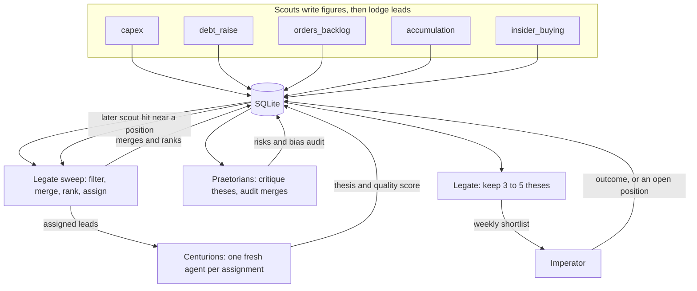

# Pipeline architecture

Design for the path from a scout finding to the few theses the Imperator reads each week. Scouts already fetch, parse, and store figures. The Legate sweep, Centurions, and Praetorians are design only: `Centurions/` and `Praetorians/` hold a one-line role note, and nothing in the repo runs those agents yet.

Each scout has a live command documented in [setup.md](setup.md).

Agents are ephemeral. A Centurion, a Praetorian, and the Legate start each run with an empty context. The SQLite database is the sole persistent memory. This repository holds schema and code only. Databases, account identifiers, and anyone's positions or results stay off the tree (local `*.sqlite` files are gitignored).

Today `shared/schema.sql` stores `runs` and `figures`, plus a small `leads` table keyed by run and ticker. The tables in [Proposed schema](#proposed-schema) are the pipeline shape. They are created by [Implemented schema](#implemented-schema).

## Flow

Scouts lodge findings. The Legate then works in private: filter, merge, rank, assign. Centurions research. Praetorians critique the theses and audit the Legate's merges. The Legate keeps three to five theses for the week. That shortlist is the only step that reaches the Imperator.



The sweep, the research, the critiques, and the merge audit stay inside the run. The Imperator sees the weekly shortlist, then records an action. A later scout hit near a position the Imperator already took comes back as an update on that position.

## Scouts

Each scout pulls official findings (SEC, ASX, company releases) and lodges leads into `leads`. A lead is one finding: ticker, lead type, source link, and the figure it rests on. Lead types match the scout folders: `capex`, `debt_raise`, `orders_backlog`, `accumulation`, `insider_buying`.

A new row starts at status `fresh`. The scout does not rank it against other lead types and does not write a thesis.

## Legate sweep

The Legate is the Portfolio Manager agent. After the scouts finish, it sweeps the fresh leads. The sweep has four jobs, and none of them are shown to the Imperator:

1. Drop leads that fail the scout's own gate or that duplicate a lead already in flight.
2. Merge leads that overlap or support each other across lead types. A capex print and a supplier order on the same spend become one lead, with the merge written to `legate_merges`.
3. Rank what remains by priority.
4. Assign the ranked leads to Centurions. Assigned rows move to status `assigned`.

The same sweep watches open positions. A new scout hit near a position the Imperator is already tracking is stored with `parent_position_id` set to that position. It is an update, not a new standalone lead, and it does not compete for a slot in the weekly shortlist on its own.

## Centurions

Centurions are ephemeral. Each run spins up new agents with no memory of earlier runs. A Centurion receives only the lead or leads the Legate assigned, plus the rubric for that lead type, and reads the sources stored on the lead.

It writes one full investment thesis per lead into `theses`, marks each rubric criterion yes or no in `lead_criteria_results`, and sets `quality_score` to the number of criteria cleared. The lead status becomes `researched`.

The rubric is fixed and stored in the database, one rubric per lead type. Every Centurion for that type answers the same yes/no list, so a score of 4 means the same thing on this run as on a run months later. Examples of criteria:

- Market cap is at least the minimum stored on the rubric.
- Insider-buying dollars clear the stored threshold.
- The debt raise is large relative to the company, on the ratio stored on the rubric.
- Order backlog grew quarter over quarter.

The quality score is the Centurion's judgment at research time. It is a count of cleared criteria. It is not revised when the Imperator later acts.

## Outcome

`outcome` is a separate column on `leads`. It stays empty through research, critique, and the weekly shortlist. The Imperator fills it only after acting on a lead. A high quality score and a later outcome are different facts: one was true when the thesis was written, the other records what the Imperator did.

## Praetorians

Praetorians are ephemeral agents as well. They read a thesis and keep critiquing it until the text states both the investment thesis and the risks, including why it would fail. Each pass is a row in `critiques`. The thesis that leaves this step is the one the Legate may put on the shortlist.

Praetorians also read `legate_merges`. They audit merges and priority ranks for bias: a lead type that always survives a merge, a ticker that always ranks first, a criterion that never changes the score. The audit note sits on the merge row. A biased merge can be split or re-ranked on a later sweep. That audit is part of the run, and it is not a separate report to the Imperator.

## Weekly shortlist

After critiques and the bias audit, the Legate filters the researched theses to three to five for the week. Those rows move to status `presented`. That shortlist is what the Imperator reads.

If the Imperator acts, status becomes `acted` and `outcome` is filled. A name the Imperator keeps watching becomes status `position`. Both fresh leads and open positions live in `leads`, distinguished by status. The next scout sweep attaches nearby hits to the position instead of opening a second lead.

## Proposed schema

Sketch of the columns below. The migration that creates them is [Implemented schema](#implemented-schema). It leaves `runs` and `figures` as they are.

`quality_score` is written when the Centurion finishes. `outcome` is written only after the Imperator acts. `parent_position_id` is set when the row updates a position the Imperator already tracks.

```sql
-- Sketch of the pipeline tables. Applied by shared/migrations/001_pipeline.sql.

CREATE TABLE leads (
  lead_id INTEGER PRIMARY KEY,
  lead_type TEXT NOT NULL,          -- capex, debt_raise, orders_backlog, accumulation, insider_buying
  ticker TEXT NOT NULL,
  company TEXT,
  run_id TEXT REFERENCES runs(run_id),
  source_url TEXT,
  summary TEXT,
  status TEXT NOT NULL DEFAULT 'fresh'
    CHECK (status IN ('fresh', 'assigned', 'researched', 'presented', 'acted', 'position')),
  parent_position_id INTEGER REFERENCES leads(lead_id),  -- update to an open position
  priority INTEGER,                 -- Legate rank during the sweep
  quality_score INTEGER,            -- count of rubric criteria cleared
  outcome TEXT,                     -- empty until the Imperator acts
  created_at TEXT NOT NULL,
  updated_at TEXT NOT NULL
);

CREATE TABLE rubrics (
  rubric_id INTEGER PRIMARY KEY,
  lead_type TEXT NOT NULL UNIQUE,
  name TEXT NOT NULL
);

CREATE TABLE rubric_criteria (
  criterion_id INTEGER PRIMARY KEY,
  rubric_id INTEGER NOT NULL REFERENCES rubrics(rubric_id),
  prompt TEXT NOT NULL,             -- one yes/no question
  sort_order INTEGER NOT NULL,
  UNIQUE (rubric_id, sort_order)
);

CREATE TABLE lead_criteria_results (
  lead_id INTEGER NOT NULL REFERENCES leads(lead_id),
  criterion_id INTEGER NOT NULL REFERENCES rubric_criteria(criterion_id),
  cleared INTEGER NOT NULL CHECK (cleared IN (0, 1)),
  note TEXT,
  PRIMARY KEY (lead_id, criterion_id)
);

CREATE TABLE theses (
  thesis_id INTEGER PRIMARY KEY,
  lead_id INTEGER NOT NULL REFERENCES leads(lead_id),
  body TEXT NOT NULL,               -- thesis plus, after critique, the risks
  written_at TEXT NOT NULL
);

CREATE TABLE critiques (
  critique_id INTEGER PRIMARY KEY,
  thesis_id INTEGER NOT NULL REFERENCES theses(thesis_id),
  body TEXT NOT NULL,               -- why it would fail, and what is still missing
  written_at TEXT NOT NULL
);

-- Audit log of the Legate sweep. Praetorians write audit_note.
CREATE TABLE legate_merges (
  merge_id INTEGER PRIMARY KEY,
  created_at TEXT NOT NULL,
  survivor_lead_id INTEGER NOT NULL REFERENCES leads(lead_id),
  merged_lead_id INTEGER REFERENCES leads(lead_id),
  priority_rank INTEGER,
  rationale TEXT,
  audited INTEGER NOT NULL DEFAULT 0 CHECK (audited IN (0, 1)),
  audit_note TEXT
);
```

`quality_score` for a lead is the number of `lead_criteria_results` rows with `passed = 1` (the sketch above calls that flag `cleared`). The rubric for the lead type is the denominator, and a rubric version stays fixed, so scores compare without rescaling.

## Implemented schema

Applied. `shared/pipeline_store.py` (`ensure_pipeline`, or `connect`) runs `shared/migrations/001_pipeline.sql` and records `001_pipeline.sql` in `schema_migrations`. Running it again does not duplicate rows. `lodge_lead`, `record_criterion_result`, and `compute_quality_score` write leads and scores. `quality_score` is the count of criteria with `passed = 1`. `outcome` stays empty until it is set on its own.

The migration sits on a database that already has `runs`, `figures`, and the earlier `leads` table, and it does not modify `scout_tests`, `debt_scout_runs`, or `debt_scout_filing_scores`. When `leads` has no `lead_id` column, the helper renames it, creates the table below, and copies every row. `rank` becomes `priority`. The old status was a pricing label (`underappreciated`, `partly`, `priced_in`, `crowded`), so that text is kept in `summary` and the pipeline status starts at `fresh`. `lead_type` comes from the scout on `runs` (`debt-raise` maps to `debt_raise`, and the same for the other scouts).

Beyond the sketch:

- `leads` adds `exchange` and `source_scout`. Status also allows `closed` and `rejected`. `parent_position_id` must reference a lead whose status is `acted` or `position`. Figure ids live in `lead_figures`.
- `rubrics` is one fixed row per lead type and version. Version 1 is seeded for `capex`, `debt_raise`, `insider_buying`, `orders_backlog`, and `accumulation`. Changing a threshold means a new version.
- `rubric_criteria` stores `name`, `description`, `threshold_value`, and `threshold_unit`. Seeded numbers (market cap, insider-buy dollars, debt-raise size versus the company, backlog quarter-over-quarter growth, stake percent, recent-filing window) are configurable defaults.
- `lead_criteria_results` stores `passed`, `evidence`, `source_url`, and `assessed_by` (a `runs.run_id`).
- `theses` stores the Centurion `run_id`, `thesis_text`, `risks`, and `quality_score`.
- `critiques` stores the Praetorian `run_id`, `critique`, `verdict` (`revise`, `accept`, or `reject`), and `round`.
- `legate_merges` stores the rationale, `priority_rank`, and `bias_audit`. The merged lead ids are rows in `legate_merge_leads`.
