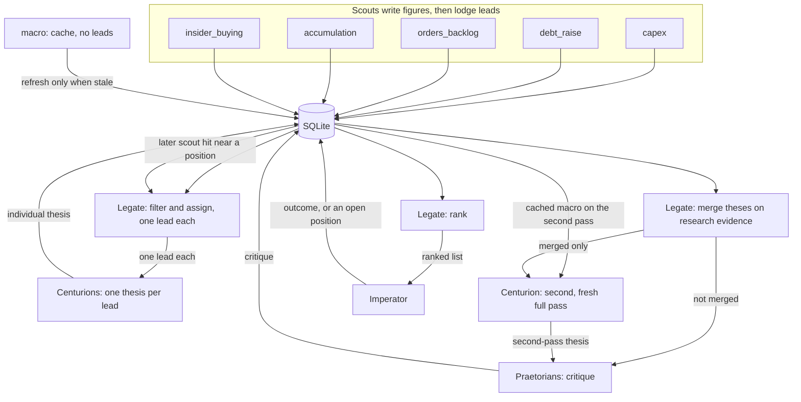

# Pipeline architecture

Design for the path from a scout finding to the few theses the Imperator reads each week. Scouts already fetch, parse, and store figures. The Legate, Centurions, and Praetorians are specified in this document, in [Centurions/README.md](../Centurions/README.md), and in [Praetorians/README.md](../Praetorians/README.md). The sweep that runs those stages is `python -m pipeline run`, then `python -m pipeline ingest` for each agent stage. The live commands do not call a model. The task-file protocol is in [agent-protocol.md](agent-protocol.md).

Each scout has a live command documented in [setup.md](setup.md).

Agents are ephemeral. A Centurion, a Praetorian, and the Legate start each run with an empty context. The SQLite database is the sole persistent memory. This repository holds schema and code only. Databases, account identifiers, and anyone's positions or results stay off the tree (local `*.sqlite` files are gitignored).

Today `shared/schema.sql` stores `runs` and `figures`, plus a small `leads` table keyed by run and ticker. The tables in [Proposed schema](#proposed-schema) are the pipeline shape. They are created by [Implemented schema](#implemented-schema).

## Flow

Scouts are the cheap filter. Centurions are the expensive research. A scout's existing code pulls and parses, deterministic thresholds and a dedupe run first, and an external agent then judges the shortlist from a task file. Only a lead that survives is lodged. Data-collection scouts do not merge. The sweep combines linkable capex, backlog, and debt into one capex-chain lead, and same-ticker insider and accumulation signals into one smart-money lead, before the Centurion. Macro stays a lead of its own. The Macro scout does not lodge leads. It refreshes a cached series only when that series is stale, and a capex-chain Centurion reads that cache. Each combined or single lead goes to one Centurion, which writes one thesis. A leftover cross-group link can still be merged after those theses exist, and only that leftover goes back for a second pass. The Legate ranks that set. The ranked list is what reaches the Imperator.



A market cap is shares outstanding times an official USD share-price figure. Shares without that price leave the cap unverified. Significance, the Centurion passes, and the Praetorian critiques are task files for an external agent. Capex chains and smart-money leads are combined in process before the first Centurion, and a macro Centurion task includes the related findings from those leads. Legate merge of a leftover cross-group link, and ranking, stay in process. The Imperator sees the ranked list, then records an action. A later scout hit near a position the Imperator already took comes back as an update on that position. It is a new lead, not a merge into the open position.

## Scouts

Each scout pulls official findings (SEC, ASX, company releases) with the code already in its folder. That pull is not a lead. Deterministic gates run first: the scout's own thresholds, then a dedupe of the pull. What remains is a shortlist. An external agent reads that shortlist from a task file and applies four judgments. It emits a row into `leads` only when the item is genuinely interesting. A reject is written to `lead_rejects` and is not inserted into `leads`. The aim is that a Centurion never receives a run of low-value leads, such as hundreds of routine bond issues.

A lodged lead is one finding: ticker, lead type, source link, the figure it rests on, and a significance assessment. Lead types match the scout folders: `capex`, `debt_raise`, `orders_backlog`, `accumulation`, `insider_buying`, plus `macro`. The macro scout still only refreshes `macro_series` and `macro_observations`, and the second-pass Centurion reads that cache. The sweep also reads those observations and lodges a `macro` lead when a series moves at least 10 percent in one month, 20 percent in three months, or two standard deviations versus the prior year, or when Brent minus WTI is outside its prior-year range. That lead carries the series ids, values, dates, and source URLs, and it enters the same agent queue as a company lead.

Each dimension is a short label plus a one-line rationale, not necessarily a number:

- **Magnitude** (`significance_magnitude`, `significance_magnitude_rationale`): how large the move is, absolute and relative to the company's size.
- **Novelty** (`significance_novelty`, `significance_novelty_rationale`): the first time this company has done it, or routine behaviour.
- **Market attention** (`significance_attention`, `significance_attention_rationale`): whether anyone else has written about or noticed it. Media and aggregators may be checked only for that. They are never a source of figures.
- **Timing** (`significance_timing`, `significance_timing_rationale`): how early this is relative to the next earnings date or catalyst. Age is measured from the event date (the insider trade date, otherwise the period end, otherwise the filing date) to the sweep date.

Per-type guidance for those four judgments is in each scout README.

### Reject log

`lead_rejects` is the searchable record of what a scout saw and did not emit. The use case is a look-back: a small company's stock jumps because a large buyer spent heavily with it, the owner missed it, and the log should show why. Search is by the lead's ticker and by any named counterparty (buyer, supplier, customer, or holder). A counterparty query is a case-insensitive token prefix (`north` matches Northwind Capital; `wind` does not match inside a token) or a ticker prefix (`amz` matches AMZN).

Each reject row stores the scout, the ticker and the CIK when known, the filing date, the source URL, and the accession. `rejection_stage` is `deterministic` (threshold or dedupe) or `agent` (the significance or hard-grade judgement). `reason` is the one-line cause. The four significance labels and their rationales are on the same row. An agent reject fills all four when the significance result rejected the figure. A deterministic reject fills the dimensions that gate used and leaves the others empty.

Named counterparties from the source text are child rows in `lead_reject_counterparties`: a normalised name, a ticker and CIK where they resolve, and a role of `buyer`, `supplier`, `customer`, or `holder`. An accumulation filer is a holder. A capex filing that names a supplier, or a supplier order that names Amazon as the buyer, is findable without reading the filing again.

```sql
-- All rejects that name AMZN as the buyer.
SELECT r.scout, r.ticker, r.filing_date, r.rejection_stage, r.reason, r.source_url
FROM lead_rejects AS r
JOIN lead_reject_counterparties AS c ON c.reject_id = r.reject_id
WHERE c.ticker = 'AMZN' AND c.role = 'buyer';

-- Every reject for one issuer, whatever the stage.
SELECT scout, filing_date, rejection_stage, reason
FROM lead_rejects
WHERE ticker = 'ACME'
ORDER BY filing_date;
```

`lead_rejects`, `lead_reject_counterparties`, and the eight significance columns on `leads` are applied by `shared/migrations/002_lead_pipeline.sql`. Market attention is the column `significance_attention`.

A new row starts at status `fresh`. The scout does not merge it with another lead, does not rank it against other lead types, and does not write a thesis.

A lead that is stored goes to one Centurion, which writes one individual thesis. After the Centurions write those theses, the Legate merges linked theses. Only a merged finding goes back to one Centurion for a second, fresh full thesis pass. A lead that is not merged gets no second pass and goes straight to the Praetorians for critique. A merged finding goes to the Praetorians after that second-pass thesis.

That second pass includes a priced-in check on any prior price run. The Centurion makes the call first, classifying the run as a new thesis, an acceleration of an existing thesis, or tail end / likely priced in, with its reasoning and evidence. It notes that call as a concern where relevant. There is no automatic rejection. The stock price and past performance come from quote data. The Praetorians then review that classification and state whether they agree or disagree, with counter-evidence.

## Macro

The Macro scout is not a lead scout. It does not emit a row into `leads` and it does not write `lead_rejects`. It caches official macro context for the second-pass Centurion: rates and yields, inflation and CPI, central-bank policy (QE, QT, forward guidance), credit spreads and funding conditions, the US dollar, oil and energy prices, fiscal policy and government spending, supply-chain disruptions, geopolitics, and election and regulatory risk. Sources are central banks, statistics agencies, and treasuries, including FRED, the BLS, the ABS, the RBA, and the US Treasury. Media is not a source.

Each series has `stale_after_hours` on `macro_series`. A run fetches the series only when the newest `macro_observations.fetched_at` is missing or older than that threshold. The second-pass Centurion reads the latest observation and does not re-pull. The first pass does not read the cache. The series list is in [Scouts/macro/README.md](../Scouts/macro/README.md). The tables are created by `Scouts/macro/migrations/001_macro.sql`, not by `shared/migrations/001_pipeline.sql` or `002_lead_pipeline.sql`. When those tables have rows, the sweep uses them. When they do not, it falls back to `cache/macro.json`.

## Assign

The Legate is the Portfolio Manager agent. After the scouts finish, it assigns fresh leads. This step does not merge.

1. Drop leads that fail the scout's own gate or that duplicate a lead already in flight. Low-significance candidates never arrive: the scout logged them and did not emit them.
2. Assign each remaining lead to one Centurion. Assigned rows move to status `assigned`. One lead, one Centurion.

The same pass watches open positions. A new scout hit near a position the Imperator is already tracking is stored with `parent_position_id` set to that position. It is an update, not a new standalone lead, and it does not compete for a slot on the ranked list on its own.

## Centurions

Centurions are ephemeral. Each run spins up new agents with no memory of earlier runs. A first-pass Centurion receives one lead and the rules file for that lead's type (`Centurions/rules/<lead_type>.md`), and reads the sources stored on the lead.

A capex Centurion works out what the spending is actually on, and which suppliers it reaches. An orders_backlog Centurion works out where the backlog came from, and which customers placed the orders. Every other lead type is researched on its own.

It writes one investment thesis for that lead into `theses`, marks each criterion pass or fail in `lead_criteria_results`, and sets `quality_score` to the number of criteria cleared. The lead status becomes `researched`. The rules file is the grading instructions. The stored rubric for that lead type is the criterion list those results point at.

The quality score is the Centurion's judgment at research time. It is a count of cleared criteria. It is not revised when the Imperator later acts.

## Legate merge

Capex, orders backlog, and debt are combined before the Centurion when the filings name each other or share a ticker. That chain is one lead. Insider buying and accumulation on the same ticker, inside the window, are one smart-money lead. Those combinations do not come back as a Legate merge.

A leftover cross-group link, such as a capex lead and an insider lead on the same company, is still merged here after the theses exist. Same-company merges of supportive theses are allowed when they were not already one chain.

A leftover merge rests on the Centurions' researched findings. It needs traceable official-source evidence. A sector match is not enough. That evidence is stored in `legate_merges.rationale`. `survivor_lead_id` is the combined lead. Constituent ids are rows in `legate_merge_leads`.

Only a merged finding goes back to one Centurion as a single new lead. That Centurion runs a second, fresh full thesis pass: grade, thesis, potential ROI, risks, timeframe, and stated assumptions. The rules files for the constituent types are the grading criteria. The output is one thesis. A lead that was not merged gets no second pass and keeps the thesis from the first pass. That unmerged thesis goes straight to the Praetorians for critique. A merged finding goes to the Praetorians after its second-pass thesis.

## Praetorians

Praetorian review is off unless the sweep is started with `--with-praetorians`. The code and the task schema stay. A run without that flag goes from the Centurion passes to ranking. Praetorians, when the flag is on, are ephemeral agents. Their only job is critique. A thesis the Legate does not merge gets no second pass and comes straight from the first thesis. A merged finding comes only after its second-pass thesis. They attack the stated assumptions, weak or non-official sources, and conclusions, with counter-evidence. On any prior price run they review the Centurion's classification, already made, and state whether they agree or disagree, with counter-evidence. They do not write an assumptions list of their own, and they do not merge or rank.

Each pass is a row in `critiques`. The thesis that leaves this step is one the Legate may rank.

## Rank

After the critiques, the Legate ranks the final theses. Rank 1 has the fewest surviving Praetorian issues, the highest ROI, and the shortest timeframe. Later ranks step down by how many risks remain and how large those risks are. A merged thesis is one entry. `--max-theses` (default 5) is how many of those rows move to status `presented` and into `data/reports/<run_id>.md`. That file is what the Imperator reads: thesis, cause to effect chain, tickers, evidence links, Praetorian verdict and objections, and macro context.

## Outcome

`outcome` is a separate column on `leads`. It stays empty through research, the second pass, critique, and ranking. The Imperator fills it only after acting on a lead. Monitoring then writes the later comparison of live brokerage performance against the thesis into that same field. A high quality score and a later outcome are different facts: one was true when the thesis was written, the other records what happened after he acted.

Acting on a lead means the Imperator has taken a position in his brokerage account. The Legate reads that portfolio and does not place orders. No account identifiers are stored in this repo. Pending stays `presented` until he answers. Acted on becomes `acted`, and stays `position` while the holding is open. Not acted on becomes `rejected`. A later lead about an open holding sets `parent_position_id` to that `acted` or `position` row. When the holding is no longer open, status moves to `closed`.

If the Imperator acts, status becomes `acted` and `outcome` is filled. A name the Imperator keeps watching becomes status `position`. The next scout pass attaches nearby hits to the position instead of opening a second competing lead.

## Proposed schema

Sketch of the columns below. The migration that creates them is [Implemented schema](#implemented-schema). It leaves `runs` and `figures` as they are.

`quality_score` is written when the Centurion finishes a pass. `outcome` is written only after the Imperator acts, and monitoring updates it from brokerage performance. `parent_position_id` is set when the row updates a position the Imperator already tracks.

```sql
-- Sketch of the pipeline tables. Applied by shared/migrations/001_pipeline.sql.
-- Significance columns, lead_rejects, and lead_reject_counterparties are
-- applied by shared/migrations/002_lead_pipeline.sql.
-- macro_series and macro_observations are not in 002. The Macro scout
-- records its own migration as 001_macro.sql in schema_migrations.

CREATE TABLE leads (
  lead_id INTEGER PRIMARY KEY,
  lead_type TEXT NOT NULL,          -- capex, debt_raise, orders_backlog, accumulation, insider_buying
  ticker TEXT NOT NULL,
  company TEXT,
  run_id TEXT REFERENCES runs(run_id),
  source_url TEXT,
  summary TEXT,
  status TEXT NOT NULL DEFAULT 'fresh'
    CHECK (status IN ('fresh', 'assigned', 'researched', 'presented', 'acted', 'position')),
  parent_position_id INTEGER REFERENCES leads(lead_id),  -- update to an open position
  priority INTEGER,                 -- Legate rank after critique
  quality_score INTEGER,            -- count of rubric criteria cleared
  outcome TEXT,                     -- empty until the Imperator acts
  -- Applied by shared/migrations/002_lead_pipeline.sql.
  significance_magnitude TEXT,             -- short label
  significance_magnitude_rationale TEXT,   -- one-line reason
  significance_novelty TEXT,
  significance_novelty_rationale TEXT,
  significance_attention TEXT,
  significance_attention_rationale TEXT,
  significance_timing TEXT,
  significance_timing_rationale TEXT,
  created_at TEXT NOT NULL,
  updated_at TEXT NOT NULL
);

CREATE TABLE rubrics (
  rubric_id INTEGER PRIMARY KEY,
  lead_type TEXT NOT NULL UNIQUE,
  name TEXT NOT NULL
);

CREATE TABLE rubric_criteria (
  criterion_id INTEGER PRIMARY KEY,
  rubric_id INTEGER NOT NULL REFERENCES rubrics(rubric_id),
  prompt TEXT NOT NULL,             -- one yes/no question
  sort_order INTEGER NOT NULL,
  UNIQUE (rubric_id, sort_order)
);

CREATE TABLE lead_criteria_results (
  lead_id INTEGER NOT NULL REFERENCES leads(lead_id),
  criterion_id INTEGER NOT NULL REFERENCES rubric_criteria(criterion_id),
  cleared INTEGER NOT NULL CHECK (cleared IN (0, 1)),
  note TEXT,
  PRIMARY KEY (lead_id, criterion_id)
);

CREATE TABLE theses (
  thesis_id INTEGER PRIMARY KEY,
  lead_id INTEGER NOT NULL REFERENCES leads(lead_id),
  body TEXT NOT NULL,               -- one thesis for one lead
  written_at TEXT NOT NULL
);

CREATE TABLE critiques (
  critique_id INTEGER PRIMARY KEY,
  thesis_id INTEGER NOT NULL REFERENCES theses(thesis_id),
  body TEXT NOT NULL,               -- critique of a final thesis
  written_at TEXT NOT NULL
);

-- Applied by shared/migrations/002_lead_pipeline.sql.
-- Searchable log of candidates a scout did not emit.
CREATE TABLE lead_rejects (
  reject_id INTEGER PRIMARY KEY,
  scout TEXT NOT NULL,                  -- capex, debt_raise, orders_backlog, accumulation, insider_buying
  ticker TEXT NOT NULL,
  cik TEXT,                             -- issuer CIK when known
  filing_date TEXT,
  source_url TEXT,
  accession TEXT,
  rejection_stage TEXT NOT NULL CHECK (rejection_stage IN ('deterministic', 'llm')),
  reason TEXT NOT NULL,
  significance_magnitude TEXT,
  significance_magnitude_rationale TEXT,
  significance_novelty TEXT,
  significance_novelty_rationale TEXT,
  significance_attention TEXT,
  significance_attention_rationale TEXT,
  significance_timing TEXT,
  significance_timing_rationale TEXT,
  created_at TEXT NOT NULL
);

CREATE TABLE lead_reject_counterparties (
  reject_id INTEGER NOT NULL REFERENCES lead_rejects(reject_id),
  role TEXT NOT NULL CHECK (role IN ('buyer', 'supplier', 'customer')),
  name_normalised TEXT NOT NULL,
  ticker TEXT,                          -- resolved ticker, when known
  cik TEXT,
  PRIMARY KEY (reject_id, role, name_normalised)
);

CREATE INDEX ix_lead_rejects_ticker ON lead_rejects(ticker);
CREATE INDEX ix_lead_rejects_cik ON lead_rejects(cik);
CREATE INDEX ix_reject_cp_ticker ON lead_reject_counterparties(ticker);
CREATE INDEX ix_reject_cp_name ON lead_reject_counterparties(name_normalised);

-- Applied by Scouts/macro/migrations/001_macro.sql, not by 001 or 002.
-- The second pass reads series_id, name, source, unit, obs_date, and value.
CREATE TABLE macro_series (
  series_id TEXT PRIMARY KEY,
  name TEXT NOT NULL,
  source TEXT NOT NULL,
  source_url TEXT NOT NULL,
  unit TEXT NOT NULL,
  frequency TEXT NOT NULL,
  stale_after_hours INTEGER NOT NULL
);

CREATE TABLE macro_observations (
  series_id TEXT NOT NULL REFERENCES macro_series(series_id),
  obs_date TEXT NOT NULL,
  value REAL NOT NULL,
  fetched_at TEXT NOT NULL,
  UNIQUE (series_id, obs_date)
);

-- Written by the Legate after individual theses exist.
-- rationale is the official-source link from that research.
CREATE TABLE legate_merges (
  merge_id INTEGER PRIMARY KEY,
  created_at TEXT NOT NULL,
  survivor_lead_id INTEGER NOT NULL REFERENCES leads(lead_id),
  merged_lead_id INTEGER REFERENCES leads(lead_id),
  priority_rank INTEGER,
  rationale TEXT,
  audited INTEGER NOT NULL DEFAULT 0 CHECK (audited IN (0, 1)),
  audit_note TEXT
);
```

`quality_score` for a lead is the number of `lead_criteria_results` rows with `passed = 1` (the sketch above calls that flag `cleared`). The rubric for the lead type is the denominator, and a rubric version stays fixed, so scores compare without rescaling.

## Implemented schema

Applied. `shared/pipeline_store.py` (`ensure_pipeline`, or `connect`) runs `shared/migrations/001_pipeline.sql` and then `002_lead_pipeline.sql`, and records each filename in `schema_migrations`. Running them again does not duplicate rows. `lodge_lead`, `record_criterion_result`, and `compute_quality_score` write leads and scores. `quality_score` is the count of criteria with `passed = 1`. `outcome` stays empty until it is set on its own.

The migration sits on a database that already has `runs`, `figures`, and the earlier `leads` table, and it does not modify `scout_tests`, `debt_scout_runs`, or `debt_scout_filing_scores`. When `leads` has no `lead_id` column, the helper renames it, creates the table below, and copies every row. `rank` becomes `priority`. The old status was a pricing label (`underappreciated`, `partly`, `priced_in`, `crowded`), so that text is kept in `summary` and the pipeline status starts at `fresh`. `lead_type` comes from the scout on `runs` (`debt-raise` maps to `debt_raise`, and the same for the other scouts).

Beyond the sketch:

- `leads` adds `exchange` and `source_scout`. Status also allows `closed` and `rejected`. `parent_position_id` must reference a lead whose status is `acted` or `position`. Figure ids live in `lead_figures`.
- `rubrics` is one fixed row per lead type and version. Version 1 is seeded for `capex`, `debt_raise`, `insider_buying`, `orders_backlog`, and `accumulation`. Changing a threshold means a new version.
- `rubric_criteria` stores `name`, `description`, `threshold_value`, and `threshold_unit`. Seeded numbers (market cap, insider-buy dollars, debt-raise size versus the company, backlog quarter-over-quarter growth, stake percent, recent-filing window) are configurable defaults.
- `lead_criteria_results` stores `passed`, `evidence`, `source_url`, and `assessed_by` (a `runs.run_id`).
- `theses` stores the Centurion `run_id`, `thesis_text`, `risks`, and `quality_score`. One row is one lead's thesis.
- `critiques` stores the Praetorian `run_id`, `critique`, `verdict` (`revise`, `accept`, or `reject`), and `round`.
- `legate_merges` stores the rationale, `priority_rank`, and `bias_audit`. `rationale` is the official-source evidence from the Centurions' research that links the two theses. The row is written when the Legate merges, after the individual theses and before Praetorian critique. Only that merged finding goes back to a Centurion for a second, fresh full thesis pass. A lead that is not merged gets no second pass and goes straight to the Praetorians. The merged finding goes to the Praetorians after its second-pass thesis. On that second pass the Centurion classifies any prior price run as a new thesis, an acceleration of an existing thesis, or tail end / likely priced in, notes that call as a concern where relevant, and the Praetorians state whether they agree or disagree, with counter-evidence. Constituent lead ids are rows in `legate_merge_leads`.
- Significance on `leads`, plus `lead_rejects` and `lead_reject_counterparties`, is applied by `shared/migrations/002_lead_pipeline.sql`. That migration also adds `evidence_refs` on `legate_merges`, return-pass columns on `theses` (`price_run`, `macro_context`, `pass_number`), `praetorian_reviews` (including the price-run agree or disagree), `rankings`, `decisions` (`acted_on`, `not_acted_on`, `pending`), and `pipeline_runs` for the token count. The sweep writes a pending decision for each presented lead. `002_lead_pipeline.sql` does not create `macro_series` or `macro_observations`.
- `macro_series` and `macro_observations` are the Macro scout cache, created by `Scouts/macro/migrations/001_macro.sql`. That name does not collide with `002_lead_pipeline.sql`. Either migration can be applied first. The second pass reads `series_id`, `name`, `source`, `unit`, `obs_date`, and `value` (and `value_text` only if that column is present). When those tables have observations, the second pass reads the latest observation of each series and does not re-pull. Catalog series with no observation are listed on that text, grouped by source (`FRED (no key)`, `EIA (no key)`, or `not loaded`). The run log says `macro: loaded (second-pass theses: N)` when that text is loaded. Otherwise it uses `cache/macro.json` or `--macro-cache`, and skips macro context when neither is present. The first pass does not read the cache. The Macro scout does not emit leads.
