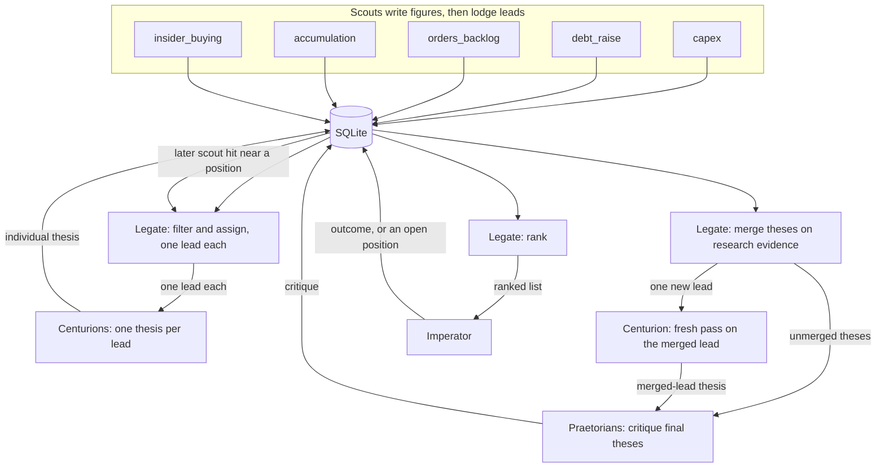

# Pipeline architecture

Design for the path from a scout finding to the few theses the Imperator reads each week. Scouts already fetch, parse, and store figures. The Legate, Centurions, and Praetorians are specified in this document, in [Centurions/README.md](../Centurions/README.md), and in [Praetorians/README.md](../Praetorians/README.md). Nothing in the repo runs those agents yet.

Each scout has a live command documented in [setup.md](setup.md).

Agents are ephemeral. A Centurion, a Praetorian, and the Legate start each run with an empty context. The SQLite database is the sole persistent memory. This repository holds schema and code only. Databases, account identifiers, and anyone's positions or results stay off the tree (local `*.sqlite` files are gitignored).

Today `shared/schema.sql` stores `runs` and `figures`, plus a small `leads` table keyed by run and ticker. The tables in [Proposed schema](#proposed-schema) are the pipeline shape. They are created by [Implemented schema](#implemented-schema).

## Flow

Scouts lodge one finding per lead. They do not merge. Each lead goes to one Centurion, which writes one thesis. The Legate then merges theses the research shows are linked, and each merge goes back to one Centurion as a single new lead for a fresh pass. Praetorians critique the final theses. The Legate ranks that set. The ranked list is what reaches the Imperator.



Research, the return pass, the critiques, and the ranking stay inside the run. The Imperator sees the ranked list, then records an action. A later scout hit near a position the Imperator already took comes back as an update on that position. It is a new lead, not a merge into the open position.

## Scouts

Each scout pulls official findings (SEC, ASX, company releases) and lodges leads into `leads`. A lead is one finding: ticker, lead type, source link, and the figure it rests on. Lead types match the scout folders: `capex`, `debt_raise`, `orders_backlog`, `accumulation`, `insider_buying`.

A new row starts at status `fresh`. The scout does not merge it with another lead, does not rank it against other lead types, and does not write a thesis.

## Assign

The Legate is the Portfolio Manager agent. After the scouts finish, it assigns fresh leads. This step does not merge.

1. Drop leads that fail the scout's own gate or that duplicate a lead already in flight.
2. Assign each remaining lead to one Centurion. Assigned rows move to status `assigned`. One lead, one Centurion.

The same pass watches open positions. A new scout hit near a position the Imperator is already tracking is stored with `parent_position_id` set to that position. It is an update, not a new standalone lead, and it does not compete for a slot on the ranked list on its own.

## Centurions

Centurions are ephemeral. Each run spins up new agents with no memory of earlier runs. A first-pass Centurion receives one lead and the rules file for that lead's type (`Centurions/rules/<lead_type>.md`), and reads the sources stored on the lead.

A capex Centurion works out what the spending is actually on, and which suppliers it reaches. An orders_backlog Centurion works out where the backlog came from, and which customers placed the orders. Every other lead type is researched on its own.

It writes one investment thesis for that lead into `theses`, marks each criterion pass or fail in `lead_criteria_results`, and sets `quality_score` to the number of criteria cleared. The lead status becomes `researched`. The rules file is the grading instructions. The stored rubric for that lead type is the criterion list those results point at.

The quality score is the Centurion's judgment at research time. It is a count of cleared criteria. It is not revised when the Imperator later acts.

## Legate merge

Merging happens here, after the individual theses exist, and not before. The Legate reads across those theses and merges any the research shows are linked.

The merge to prioritise is cross-company capex-to-backlog. A capex thesis that shows what the buyer is spending, and with which supplier, pairs with that supplier's orders_backlog thesis. Same-company merges of supportive theses are allowed. They are not the priority.

A merge rests on the Centurions' researched findings, not on the raw scout rows. It needs traceable official-source evidence that links the two: the buyer's capex filing names the supplier, the supplier's filing names the customer or contract, or another official-source link the research cites. A sector match is not enough. That evidence is stored in `legate_merges.rationale`. `survivor_lead_id` is the combined lead. Constituent ids are rows in `legate_merge_leads`.

Each merged finding goes back to one Centurion as a single new lead. That Centurion runs a fresh full pass: grade, thesis, potential ROI, risks, timeframe, and stated assumptions. The rules files for the constituent types are the grading criteria. The output is one thesis. Leads that were not merged keep the thesis from the first pass. Those unmerged theses, plus the new merged-lead theses, are the final set.

## Praetorians

Praetorians are ephemeral agents. Their only job is critique. They read each final thesis: an individual thesis the Legate did not merge, or the new thesis from the return pass. They attack the stated assumptions, weak or non-official sources, and conclusions, with counter-evidence. They do not write an assumptions list of their own, and they do not merge or rank.

Each pass is a row in `critiques`. The thesis that leaves this step is one the Legate may rank.

## Rank

After the critiques, the Legate ranks the final theses. Rank 1 has the fewest surviving Praetorian issues, the highest ROI, and the shortest timeframe. Later ranks step down by how many risks remain and how large those risks are. A merged thesis is one entry. The Legate keeps three to five for the week. Those rows move to status `presented`. That ranked list is what the Imperator reads.

## Outcome

`outcome` is a separate column on `leads`. It stays empty through research, the return pass, critique, and ranking. The Imperator fills it only after acting on a lead. Monitoring then writes the later comparison of live brokerage performance against the thesis into that same field. A high quality score and a later outcome are different facts: one was true when the thesis was written, the other records what happened after he acted.

Acting on a lead means the Imperator has taken a position in his brokerage account. The Legate reads that portfolio and does not place orders. No account identifiers are stored in this repo. Pending stays `presented` until he answers. Acted on becomes `acted`, and stays `position` while the holding is open. Not acted on becomes `rejected`. A later lead about an open holding sets `parent_position_id` to that `acted` or `position` row. When the holding is no longer open, status moves to `closed`.

If the Imperator acts, status becomes `acted` and `outcome` is filled. A name the Imperator keeps watching becomes status `position`. The next scout pass attaches nearby hits to the position instead of opening a second competing lead.

## Proposed schema

Sketch of the columns below. The migration that creates them is [Implemented schema](#implemented-schema). It leaves `runs` and `figures` as they are.

`quality_score` is written when the Centurion finishes a pass. `outcome` is written only after the Imperator acts, and monitoring updates it from brokerage performance. `parent_position_id` is set when the row updates a position the Imperator already tracks.

```sql
-- Sketch of the pipeline tables. Applied by shared/migrations/001_pipeline.sql.

CREATE TABLE leads (
  lead_id INTEGER PRIMARY KEY,
  lead_type TEXT NOT NULL,          -- capex, debt_raise, orders_backlog, accumulation, insider_buying
  ticker TEXT NOT NULL,
  company TEXT,
  run_id TEXT REFERENCES runs(run_id),
  source_url TEXT,
  summary TEXT,
  status TEXT NOT NULL DEFAULT 'fresh'
    CHECK (status IN ('fresh', 'assigned', 'researched', 'presented', 'acted', 'position')),
  parent_position_id INTEGER REFERENCES leads(lead_id),  -- update to an open position
  priority INTEGER,                 -- Legate rank after critique
  quality_score INTEGER,            -- count of rubric criteria cleared
  outcome TEXT,                     -- empty until the Imperator acts
  created_at TEXT NOT NULL,
  updated_at TEXT NOT NULL
);

CREATE TABLE rubrics (
  rubric_id INTEGER PRIMARY KEY,
  lead_type TEXT NOT NULL UNIQUE,
  name TEXT NOT NULL
);

CREATE TABLE rubric_criteria (
  criterion_id INTEGER PRIMARY KEY,
  rubric_id INTEGER NOT NULL REFERENCES rubrics(rubric_id),
  prompt TEXT NOT NULL,             -- one yes/no question
  sort_order INTEGER NOT NULL,
  UNIQUE (rubric_id, sort_order)
);

CREATE TABLE lead_criteria_results (
  lead_id INTEGER NOT NULL REFERENCES leads(lead_id),
  criterion_id INTEGER NOT NULL REFERENCES rubric_criteria(criterion_id),
  cleared INTEGER NOT NULL CHECK (cleared IN (0, 1)),
  note TEXT,
  PRIMARY KEY (lead_id, criterion_id)
);

CREATE TABLE theses (
  thesis_id INTEGER PRIMARY KEY,
  lead_id INTEGER NOT NULL REFERENCES leads(lead_id),
  body TEXT NOT NULL,               -- one thesis for one lead
  written_at TEXT NOT NULL
);

CREATE TABLE critiques (
  critique_id INTEGER PRIMARY KEY,
  thesis_id INTEGER NOT NULL REFERENCES theses(thesis_id),
  body TEXT NOT NULL,               -- critique of a final thesis
  written_at TEXT NOT NULL
);

-- Written by the Legate after individual theses exist.
-- rationale is the official-source link from that research.
CREATE TABLE legate_merges (
  merge_id INTEGER PRIMARY KEY,
  created_at TEXT NOT NULL,
  survivor_lead_id INTEGER NOT NULL REFERENCES leads(lead_id),
  merged_lead_id INTEGER REFERENCES leads(lead_id),
  priority_rank INTEGER,
  rationale TEXT,
  audited INTEGER NOT NULL DEFAULT 0 CHECK (audited IN (0, 1)),
  audit_note TEXT
);
```

`quality_score` for a lead is the number of `lead_criteria_results` rows with `passed = 1` (the sketch above calls that flag `cleared`). The rubric for the lead type is the denominator, and a rubric version stays fixed, so scores compare without rescaling.

## Implemented schema

Applied. `shared/pipeline_store.py` (`ensure_pipeline`, or `connect`) runs `shared/migrations/001_pipeline.sql` and records `001_pipeline.sql` in `schema_migrations`. Running it again does not duplicate rows. `lodge_lead`, `record_criterion_result`, and `compute_quality_score` write leads and scores. `quality_score` is the count of criteria with `passed = 1`. `outcome` stays empty until it is set on its own.

The migration sits on a database that already has `runs`, `figures`, and the earlier `leads` table, and it does not modify `scout_tests`, `debt_scout_runs`, or `debt_scout_filing_scores`. When `leads` has no `lead_id` column, the helper renames it, creates the table below, and copies every row. `rank` becomes `priority`. The old status was a pricing label (`underappreciated`, `partly`, `priced_in`, `crowded`), so that text is kept in `summary` and the pipeline status starts at `fresh`. `lead_type` comes from the scout on `runs` (`debt-raise` maps to `debt_raise`, and the same for the other scouts).

Beyond the sketch:

- `leads` adds `exchange` and `source_scout`. Status also allows `closed` and `rejected`. `parent_position_id` must reference a lead whose status is `acted` or `position`. Figure ids live in `lead_figures`.
- `rubrics` is one fixed row per lead type and version. Version 1 is seeded for `capex`, `debt_raise`, `insider_buying`, `orders_backlog`, and `accumulation`. Changing a threshold means a new version.
- `rubric_criteria` stores `name`, `description`, `threshold_value`, and `threshold_unit`. Seeded numbers (market cap, insider-buy dollars, debt-raise size versus the company, backlog quarter-over-quarter growth, stake percent, recent-filing window) are configurable defaults.
- `lead_criteria_results` stores `passed`, `evidence`, `source_url`, and `assessed_by` (a `runs.run_id`).
- `theses` stores the Centurion `run_id`, `thesis_text`, `risks`, and `quality_score`. One row is one lead's thesis.
- `critiques` stores the Praetorian `run_id`, `critique`, `verdict` (`revise`, `accept`, or `reject`), and `round`.
- `legate_merges` stores the rationale, `priority_rank`, and `bias_audit`. `rationale` is the official-source evidence from the Centurions' research that links the two theses. The row is written when the Legate merges, after the individual theses and before Praetorian critique. Constituent lead ids are rows in `legate_merge_leads`.
